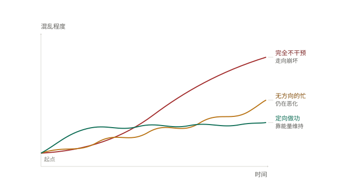
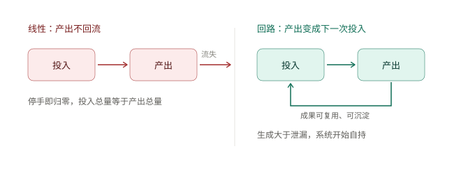

# 01 · 系统与自然规律

> 这五个模型是今天讨论的主线，也是 "A+B=2B" 这类直觉被反复校准的地方。

---

## 1. 熵增 / 做功降熵（Entropy & Work）

- **一句话**：不加干预就变乱；维持有序要靠持续、有方向的能量输入。
- **来源**：热力学第二定律（物理学）。严格前提是**孤立系统**。
- **核心机制**：封闭系统不输入能量，熵必然上升；**主动做功 = 输入能量 = 局部降熵**，而非"主动也在熵增"。
- **常见误用**：
  - 把"主动"等同于熵增——错。让事情变乱的不是主动，是**没有方向的主动**（做了负功）。
  - "只要我想变好，就可能变好"——错。意愿不产生功，只有具体动作才产生功。"想维护关系"不产生能量，"说一句我最近忽略你了"才产生。
- **商业映射**：收入/客户/口碑默认衰减，不做维护就每月自然掉一点；预算应单列"维护"项（约 20% 时间），区分"忙"与"做功"。

*图：完全不干预 → 走向崩坏；无方向的忙 → 仍在恶化；只有定向做功才能把混乱压在低位维持。*

---

## 2. 临界质量（Critical Mass）

- **一句话**：系统越过阈值后不再需要外部点火，能自持运转。
- **来源**：核物理（链式反应）。每次裂变产生的中子至少引发下一次裂变。
- **核心机制**：关键在于**自持**——一个需要外部点火的系统，突然变成自己转动的系统。
- **常见误用**：
  - 类比"及格线 60 分"不成立。及格线是人为判定门槛，59→60 无任何系统变化；临界质量是状态跃迁。
  - 类比"AI 涌现"方向对但有三处差别：机制明确 vs 未解；达到后持续释放 vs 只是能力上线；物理事实 vs 部分评测假象（Schaeffer 等指出不少涌现是评测方式造成的错觉）。
- **关键判据**：有没有**回流**？泄漏多大？有没有**点火源**（第一笔钱/种子用户/可讲案例）？没回流结构，努力二十年也到不了临界。

---

## 3. 自催化 A+B=2B（Autocatalysis）

- **一句话**：产物本身成为催化剂，使反应自我加速；但底物耗尽即封顶。
- **来源**：物理化学 / 非线性动力学。S 型曲线：诱导期 → 爆发 → 平台。
- **核心机制**：A（底物/燃料）+ B（催化剂兼产物）→ 2B。B 净增 1 个，代价是消耗 1 个 A。**B 不自行繁殖，它把 A 转化成 B。**
- **常见误用**：
  - "投入 B 获得 2B"漏了 A 的限制——没有 A，B 再多也不反应。
  - 以为能无限指数增长——错，A 有限，必然平台期。
  - 忽略 B 会衰减（模板过时、口碑淡化、代码腐化），需持续补充。
- **商业映射**：B = 课件/口碑/复用代码/选题库；A = 新学员/流量/新需求。瓶颈永远在 A，不在 B——拼命打磨 B 而 A 断供，就是"产品越好越卖不动"。
- **延伸**：Autocatalytic set（自催化集合）——一组反应互相为对方提供催化剂而自持，是生命起源研究的核心概念，比商业畅销书的"飞轮"转述更准确。

---

## 4. 正反馈（Positive Feedback）

- **一句话**：输出回流、影响下一次输入，形成最小增强闭环。
- **来源**：系统动力学 / 控制论。
- **核心机制**：产出→投入的回流。下图右半「回路」单环即为正反馈。
- **与飞轮区别**：正反馈只有两节点一个环（最小闭环）；飞轮多了"多环节咬合 + 动量储存"两个条件。

*图：左「线性」产出不回流，停手即归零；右「回路」产出变成下一次投入，生成大于泄漏即开始自持。正反馈即右图的最小闭环；飞轮再加"多环节咬合 + 动量储存"。*

---

## 5. 飞轮（Flywheel）

- **一句话**：多环节互相推动、能量可储存，越推越省力，形成壁垒。
- **来源**：运营管理（亚马逊经典飞轮：低价→流量→第三方→选品→体验→再压成本）。
- **核心机制**：至少 3–4 个环节互相加力，且系统有惯性（不推也会转一阵）。
- **常见误用**：把单环正反馈当成飞轮——单环易搭也易被抄；飞轮难搭却抄不了单点，是壁垒来源。
- **负向飞轮同样成立且转得更快**：一次交付事故→差评→招生变难→降门槛→更差评。负面信息传播速度天然高于正面，守交付底线比追增长更优先。
- **内容/讲师飞轮示例**：内容输出→专业信任→试听/低价课→真实案例→案例反哺素材→内容更好（回环）。断裂点在"案例未回流"与"低价到正价未承接"。
